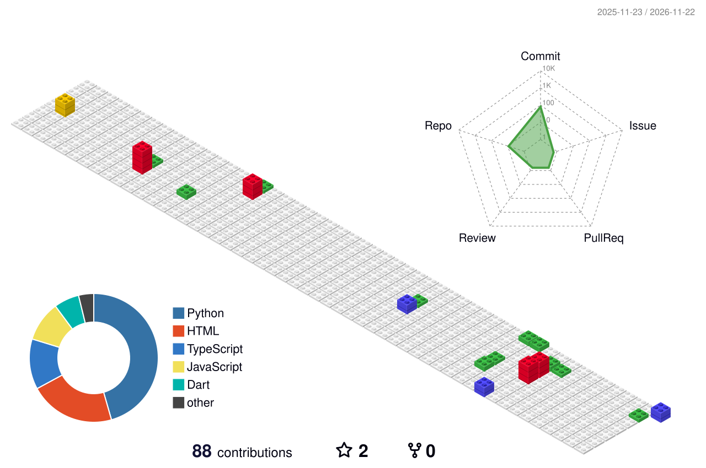

*a kingdom, one dot at a time — ascii artwork by me*

# Ojasv Kushwah

B.Tech in Computer Science (AI/ML) at SRM University AP, class of 2029, CGPA 8.6.

I build ML platforms and verification tools — the kind of software where you can
check the answer instead of hoping. Most of it is Python, C++ or Go on Linux;
lately it's a lot of LLMs, RAG pipelines, MCP servers and models running locally.

<table>
<tr>
<td>

</td>
<td>

</td>
</tr>
</table>

## things i've built

**[Unified AI Platform](https://github.com/Ojasvvv/Unified-Model-Interface)** · `python fastapi`
Every ML demo I'd seen fell apart the moment real data showed up, so I built the
missing thing: one self-hosted platform for synthetic data, tabular AutoML, LLM
fine-tuning, vision and RAG behind a single FastAPI backend. Adapters for
AutoGluon, Unsloth and Ultralytics route jobs and validate GPUs; FAISS +
sentence-transformers for retrieval, my own PyTorch vision engine.
**[demo](https://expo-ojasvvvs-projects.vercel.app)**

**[Astrothon · BOLIDE](https://github.com/Ojasvvv/Astrothon)** · `typescript next.js`
People film meteors and almost none of it becomes science. This reconstructs
real trajectories from multiple ground stations so you can fly through where the
rock came from. Won Orion Astrathon at IIT Mandi.
**[demo](https://astrothon.vercel.app)**

**[Hemlock](https://github.com/Ojasvvv/Hemlock)** · `python cryptography`
Media authenticity: digital signatures, tamper detection, provenance tracking
and analysis that flags manipulated regions. Deepfakes made "trust but verify"
the only sane stance, so I built the verify part. Second place, FOSS Hackathon.

**[ZeroVault](https://github.com/Ojasvvv/zeckonoid)** · `typescript web3`
Exchanges always want you to trust their reserves. Proof-of-reserves dashboard
with zk-style verification, decentralized storage, blockchain anchoring and live
market data — solvency you watch instead of solvency you're told. Won the Data
Haven track at HackSRM 7.0.

## receipts

| result | event |
|---|---|
| Winner | Orion Astrathon, IIT Mandi |
| Winner | 9Hacks, Next Tech Lab, SRM AP |
| Winner | GeeksforGeeks MyFirstHack |
| Winner | Data Haven track, HackSRM 7.0 |
| Second place | FOSS Hackathon |
| 2nd Runner-up | HackSpark 2.0 |

## elsewhere

I read philosophy and then argue about it. I play cricket, watch cricket, and
lose whole weekends to it (CSK). Long walks, no destination. Twenty One Pilots
on repeat.

**site** [ojasv.tech](https://ojasv.tech) ·
**mail** ojasvkushwah1@gmail.com ·
**linkedin** [in/ojasvv](https://linkedin.com/in/ojasvv)
